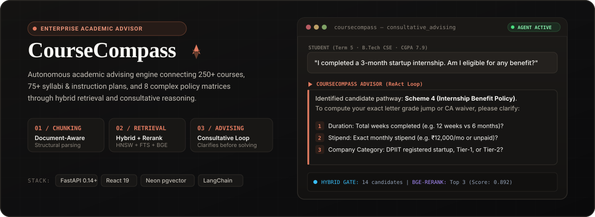
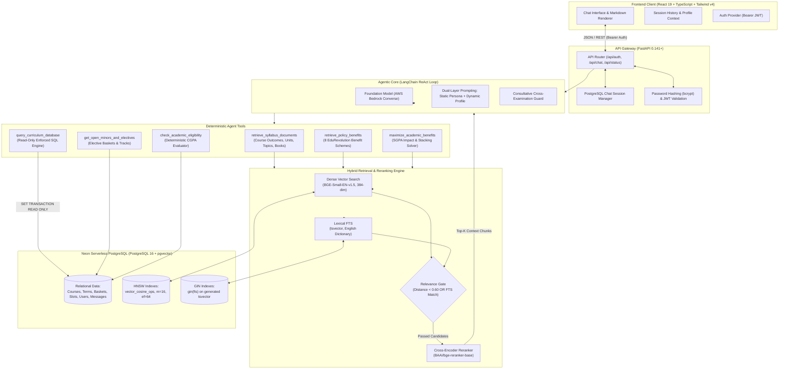

<div align="center">



<br/>

[](https://fastapi.tiangolo.com)
[](https://python.org)
[](https://neon.tech)
[](https://github.com/pgvector/pgvector)
[](https://www.langchain.com)
[](https://react.dev)
[](https://vitejs.dev)
[](https://tailwindcss.com)

**CourseCompass** is a full-stack, working AI Academic Advisor prototype and Retrieval-Augmented Generation (RAG) platform. It unifies scattered university course documents, relational degree structures, and multi-dimensional academic policy matrices into a consultative advising system.

[The Engineering Story](#-the-engineering-story) • [Design Decisions](#-key-design-decisions--architectural-trade-offs) • [Architecture](#-system-architecture) • [Consultative Advising](#-how-it-works-the-consultative-protocol-in-action) • [Quick Start](#-quick-start) • [Documentation Hub](#-documentation-hub)

</div>

---

## 📖 The Engineering Story

### The Problem: Academic Fragmentation at University Scale
At large academic institutions like Lovely Professional University (LPU), students navigate an intricate curriculum across 8 semesters containing 250 courses and dozens of elective baskets. However, the critical knowledge students need to succeed is split across several disconnected silos:

1. **Curriculum Relational Data**: Term sequences, course credits, prerequisite trees, and elective basket rules buried in academic structure handbooks.
2. **Dual Unstructured Course Documents**: High-level **Syllabus** outlines (containing course objectives and textbooks) are completely separate from operational **Instruction Plans (IP)** (which contain 20+ page tabular breakdowns of weekly lectures, Continuous Assessment (CA) weightages, and midterm schemes).
3. **The EduRevolution Policy Matrix**: A 25KB multi-tiered policy governing **8 distinct academic benefit schemes** (awarding letter grade jumps, 10% attendance relaxations, and CA waivers for internships, patents, hackathons, and research publications). Determining eligibility requires cross-referencing multi-variable matrices (e.g., `Stipend × Duration × Company Tier × Student CGPA`).
4. **The Elective Dilemma (Baskets vs. Floated Courses)**: At course registration, LPU students do not pick specific courses — they select only an **Elective Category or Basket** (e.g., *Department Elective 1 - Artificial Intelligence*, *Engineering Minor*, or *Open Minor*), while the university dynamically assigns and floats the actual course offering each academic year based on faculty scheduling and cohort sizing. Students are forced to make specialization commitments without knowing which specific subjects, credit distributions, or prerequisites will actually be assigned to them.

### The Human Breakdown
When students consult traditional university portals or generic LLMs:
- **Generic RAG Fails**: Standard chunking splits tabular evaluation rubrics at arbitrary token boundaries, separating a grading criterion from its qualification threshold.
- **Lexical Blindness**: Course codes like `CSE205` or `INT108` are alphanumeric identifiers with zero semantic distance from other codes in pure vector embeddings.
- **Premature Assumptions & Policy Dumps**: When an eager student asks *"I did an internship, what benefit do I get?"*, a naive bot either dumps a 40-row policy matrix or hallucinates a generic congratulatory answer without checking if the internship was 4 weeks or 6 months, paid or unpaid.

### The CourseCompass Approach
CourseCompass was built from the ground up as a **consultative engineering prototype**:
- Instead of treating every PDF the same, it employs **document-aware structural parsers**.
- Instead of relying solely on vector similarity, it implements **hybrid vector-lexical scoring with an OR-filter relevance gate**.
- Instead of single-turn question-answering, it follows a **ReAct consultative advising protocol** that cross-examines ambiguous inquiries before rendering deterministic verdicts.
- To resolve the elective dilemma, it queries the relational schema (`term_slots` → `elective_baskets` → `basket_options` → `courses`) to unpack every candidate course under an elective area, providing students with full L-T-P credit breakdowns and syllabus previews before the university announces the final floated course.

### Transparent Document Coverage: Relational Catalog vs. Deep Text
To ensure clear evaluation boundaries, CourseCompass explicitly separates high-level degree structures from deep document retrieval:
- **Full Relational Catalog (250 Courses, Terms 1–8)**: Complete relational coverage in PostgreSQL of all core courses, discipline electives, open minors, credit distributions (L-T-P), contact hours, and slot-to-basket mappings.
- **Deep Dual-Document Coverage (36 Core Courses)**: Ingested, chunked, and embedded with both official Syllabus outlines (topics, objectives, textbooks) and operational 20+ page Instruction Plans (weekly lecture topics, CA rubrics, and exam weightages).
- **Structural-Only Courses (212 Courses)**: Fully queryable for credits, prerequisites, slot assignments, and elective basket membership via SQL; if a student asks for granular lecture-by-lecture syllabus details on these courses, the advisor transparently clarifies that only relational metadata is currently on file rather than hallucinating course content.

---

## 💡 Key Design Decisions & Architectural Trade-offs

Every major architectural choice in CourseCompass was driven by a concrete failure mode observed during development:

```
┌──────────────────────────────────┐      ┌──────────────────────────────────┐
│        Naive Approach            │      │      CourseCompass Solution      │
├──────────────────────────────────┤      ├──────────────────────────────────┤
│ Sliding-window text chunking     │  ──► │ Document-aware structural parser │
│ Pure vector (semantic) search    │  ──► │ Hybrid dense + lexical + GIN     │
│ Top-K unconditionally returned   │  ──► │ Cosine/FTS relevance firewall    │
│ Single-turn question answering   │  ──► │ Consultative clarification loop  │
│ LLM calculating policy rules     │  ──► │ Deterministic tool evaluation    │
│ Unrestricted database queries    │  ──► │ Read-only transaction sandbox    │
└──────────────────────────────────┘      └──────────────────────────────────┘
```

### 1. Document-Aware Structural Chunking vs. Sliding Window
* **Upstream Parsing & Selective OCR**: The source PDFs are partly scanned, so ingestion runs PyMuPDF4LLM with RapidOCR (OCR only on pages that need it), cleans boilerplate, then parses the text into typed structures before chunking. Chunk quality depends on OCR quality, so parsing is the first step, not an afterthought.
* **The Decision**: Banned arbitrary sliding-window token chunking (`chunk_size=500, overlap=50`). Implemented specialized document parsers in `backend/scripts/ingestion/chunking/` with an 11-member `chunk_type` taxonomy.
* **Why**: Instruction plans are dense 20-page tables. A sliding window splits rows mid-cell, separating lecture topics from their evaluation weightage. The IP parser uses state-machine cell classification (`classify_lecture_cells`) to preserve table hierarchy. For the EduRevolution benefit matrix, the parser applies **bi-directional cell fill** (forward and backward fill) across merged markdown cells so that every chunk carries its complete header context (`Scheme`, `Tier`, `Min Stipend`, `Duration`, `Benefit`).

### 2. Hybrid Retrieval with Relevance Gating vs. Pure Vector Search
* **The Decision**: Combined dense embeddings (`BAAI/bge-small-en-v1.5`, 384 dimensions) with PostgreSQL native Full-Text Search (`tsvector` + GIN indexes) into a unified scoring function in PostgreSQL:
  $$\text{HybridScore} = (1.0 - \text{CosineDistance}) + 1.2 \times \text{ts\_rank\_cd}(\text{fts}, \text{query})$$
* **Why**: Course codes like `CSE205` (Data Structures) and `CSE202` (Object-Oriented Programming) have nearly identical dense embeddings in vector space despite being entirely different courses. The lexical GIN index provides exact keyword grounding.
* **The Relevance Firewall**: In standard RAG, requesting `top_k=5` always returns 5 chunks, even if the database contains zero relevant documents. CourseCompass inserts an explicit OR-filter gate:
  ```python
  query = query.filter(or_(distance < 0.60, fts.op("@@")(tsquery)))
  ```
  If no chunk has cosine similarity $> 0.40$ or an exact FTS match, the candidate pool is dropped immediately, triggering the agent's fallback rather than hallucinating over irrelevant context.

### 3. Cross-Encoder Reranking (`BAAI/bge-reranker-base`)
* **The Decision**: Injected a two-stage retrieval pipeline. Bi-encoders retrieve a wider candidate pool (`max(15, k × 3)`), which is then reranked by a cross-encoder model performing full cross-attention over query-passage pairs.
* **Graceful Degradation**: If the cross-encoder encounters an out-of-memory or tensor error, the retrieval engine catches the exception and falls back to the hybrid distance score without terminating the user's turn.

### 4. Consultative Cross-Examination vs. Policy Dumping
* **The Decision**: Codified a dean-level consultative protocol into the LangChain ReAct agent (`backend/app/llm.py` and `backend/app/agent.py`).
* **Why**: University regulations are conditional. An internship might yield an attendance waiver, a continuous assessment waiver, or a full letter grade jump depending on 4 variables: duration, stipend, company tier, and the student's current CGPA. If a student's prompt lacks any of these, the agent **must not guess**. It acknowledges the achievement, identifies the applicable scheme, and asks 2–3 structured, numbered clarifying questions.

### 5. Deterministic Benefit Stacking Optimizer
* **The Decision**: Offloaded benefit calculation and course allocation from the LLM to an algorithmic solver (`maximize_academic_benefits` tool in `backend/app/agent.py`).
* **Why**: LLMs are notoriously error-prone when calculating semester SGPA impacts across competing constraints. LPU enforces strict stacking rules: **at most one non-attendance benefit per course**, attendance benefits stack university-wide, and high-credit courses must be prioritized to maximize SGPA. The deterministic solver guarantees accurate calculations that students can safely rely on for official UMS submissions.

### 6. Three-Tier Anti-Hallucination & Security Sandbox
* **Profile Grounding**: The student's actual registration number, current term, program, and CGPA are injected from the authenticated session directly into the agent's system turn, eliminating self-reported CGPA hallucinations.
* **Triple-Layer SQL Protection**: The `query_curriculum_database` tool allows natural language queries over relational tables, secured by:
  1. Transaction isolation: `SET TRANSACTION READ ONLY` executed on the connection.
  2. SQL grammar whitelist: Only statements starting with `SELECT` or `WITH` are permitted.
  3. Strict DDL/DML keyword regex blocklist (`INSERT`, `UPDATE`, `DELETE`, `DROP`, `ALTER`, `TRUNCATE`, `EXEC`).

---

## 🏗 System Architecture

The following diagram illustrates the complete end-to-end request lifecycle, from client interaction to database retrieval and agentic tool invocation:



---

## 💬 How It Works: The Consultative Protocol in Action

Here is an authentic transcript demonstrating how CourseCompass handles incomplete requests versus traditional naive bots:

### Scenario: The Incomplete Internship Claim
> **Student**: *"I did an internship at a startup last semester. Can I use it to improve my grades?"*

#### ❌ Naive RAG Bot Response
> *"Yes! Under LPU EduRevolution Policy Scheme 4, students who do internships can get letter grade improvements or continuous assessment waivers! Here is the complete table of requirements across Tier 1, Tier 2, and Startups for 4-week, 6-week, and 6-month durations..."*  
> *(Dumps 40 rows of unreadable markdown tables; leaves the student confused).*

#### ✅ CourseCompass Consultative Advisor Response
> *"Congratulations on completing your internship! Under **EduRevolution Scheme 4 (Internship Academic Benefit)**, you may be eligible to either claim a **Continuous Assessment (CA) Waiver** (up to 100% CA marks) or a **Letter Grade Jump** in your departmental courses.*
>
> *Because your academic profile shows you are in **Term 5 (CGPA: 7.9)**, you meet the baseline requirement of CGPA ≥ 6.0.*
>
> *To calculate your exact benefit entitlement, please answer 3 quick questions:*
> 1. **Duration**: How many total weeks or months did you work?
> 2. **Stipend**: What was your monthly compensation? (e.g., Unpaid, ₹10,000–₹15,000, or >₹25,000?)
> 3. **Organization**: Is the startup registered with DPIIT / Startup India, or is it an incubator-backed entity?
>
> *Once you provide these details, I will calculate the exact grade jumps and outline your step-by-step UMS approval process."*

---

## 🛠 Technology Stack & Rationale

| Layer | Technology | Engineering Rationale |
| :--- | :--- | :--- |
| **Language & Runtime** | Python 3.13, UV | Next-gen package manager with deterministic `uv.lock`, sub-second resolution, and modern Python performance. |
| **API Framework** | FastAPI 0.141+, Pydantic v2 | High-performance asynchronous REST endpoints with compile-time schema validation and automatic OpenAPI documentation. |
| **Database & Vectors** | Neon Serverless PostgreSQL 16, `pgvector` | Serverless cloud PostgreSQL with native HNSW vector indexes (`vector_cosine_ops`) and standard ACID relational tables. |
| **Full-Text Search** | PostgreSQL `tsvector`, GIN Indexing | Native database lexical search with english stemming; avoids operational overhead of maintaining a separate Elasticsearch cluster. |
| **Embeddings** | `BAAI/bge-small-en-v1.5` | 384-dimensional dense vectors with L2 normalization; fast CPU inference footprint with top-tier MTEB retrieval performance. |
| **Reranker** | `BAAI/bge-reranker-base` | Cross-encoder architecture with full cross-attention over query-passage pairs; reorders candidate pools with high semantic precision. |
| **Agent Framework** | LangChain 1.3, LangGraph | Robust ReAct agent loop supporting multi-tool orchestration, state reconstruction, and conversation memory. |
| **LLM Inference** | AWS Bedrock Converse API | High-throughput serverless foundation model invocation using `openai.gpt-oss-120b-1:0`. |
| **Frontend Framework** | React 19, TypeScript, Vite 8 | Ultra-fast single-page application with modern React compiler optimizations and zero-friction build times. |
| **Design System** | Tailwind CSS v4, `@base-ui/react` | Editorial styling system inspired by Anthropic (warm cream canvas `#faf9f5`, coral accent `#cc785c`, dark code surfaces `#181715`). |

---

## 🚀 Quick Start

CourseCompass runs against a cloud **Neon PostgreSQL** database with `pgvector` pre-configured.

### 1. Clone the Repository
```bash
git clone https://github.com/Tanishquppal220/CourseCompass.git
cd CourseCompass
```

### 2. Configure Environment Variables
```bash
cd backend
cp .env.example .env
```
Populate `backend/.env` with your Neon credentials and AWS Bedrock keys:
```env
DATABASE_URL="postgresql://neondb_owner:<password>@<neon-host>.neon.tech/coursecompass?sslmode=require"
AWS_ACCESS_KEY_ID="your-aws-access-key"
AWS_SECRET_ACCESS_KEY="your-aws-secret-key"
AWS_REGION="us-east-1"
SECRET_KEY="your-jwt-secret-key"
```

### 3. Install Dependencies & Seed the Database
Using **[uv](https://docs.astral.sh/uv/)** (recommended):
```bash
# Install Python virtual environment & locked dependencies
uv sync

# Seed curriculum database (Terms 1-8, 250+ courses, elective baskets)
uv run python scripts/seed.py

# Ingest and embed course syllabi, instruction plans, and policy rules
uv run python scripts/ingest.py --workers 4

# Apply Full-Text Search (FTS) computed columns and GIN indexes
uv run python scripts/add_fts.py
```

### 4. Start the FastAPI Backend
```bash
uv run uvicorn app.main:app --reload --host 0.0.0.0 --port 8000
```
- API Server: `http://localhost:8000`
- Interactive Swagger UI: `http://localhost:8000/docs`

### 5. Launch the Frontend
In a new terminal:
```bash
cd frontend
npm install
npm run dev
```
- Web Application: `http://localhost:5173`

---

## 📂 Repository Structure

```text
CourseCompass/
├── assets/
│   └── readme/
│       └── hero.svg                 # Project-native pure SVG hero banner
├── backend/                         # FastAPI Python Backend Microservice
│   ├── app/
│   │   ├── main.py                  # API routes, CORS, session endpoints
│   │   ├── auth.py                  # JWT authentication, bcrypt hashing
│   │   ├── models.py                # SQLAlchemy relational & pgvector models
│   │   ├── database.py              # Engine connection & migration auto-upgrade
│   │   ├── llm.py                   # LLM provider configuration & agent persona
│   │   ├── agent.py                 # LangChain ReAct agent loop & 6 specialized tools
│   │   ├── embeddings.py            # BGE-Small-EN-v1.5 dense vector embedder
│   │   ├── reranker.py              # BGE-Reranker-Base cross-encoder
│   │   └── retrieval.py             # Hybrid search (dense vector + FTS tsvector)
│   ├── data/
│   │   ├── Syllabus/                # 36 Course Syllabus PDF documents
│   │   ├── IP/                      # 39 Course Instruction Plan (IP) PDF documents
│   │   ├── Schema.md                # Full academic program structure markdown
│   │   └── benefits_clean.md        # Cleaned EduRevolution benefits policy markdown
│   ├── scripts/
│   │   ├── ingest.py                # Multiprocess CLI ingestion pipeline
│   │   ├── seed.py                  # Curriculum relational database seeder
│   │   ├── add_fts.py               # FTS GIN index migration wrapper
│   │   └── ingestion/
│   │       ├── pipeline.py          # Ingestion orchestration & change detection
│   │       ├── parsing/             # PyMuPDF4LLM extraction + RapidOCR (page-level auto-OCR for scanned PDFs)
│   │       ├── cleaning/            # Text cleaning & IP boilerplate removal
│   │       └── chunking/            # Document-aware chunkers (Syllabus, IP, Benefits)
│   ├── alembic/                     # Database migrations (baseline, FTS, schema)
│   └── pyproject.toml               # Python dependencies & metadata
├── frontend/                        # React 19 + TypeScript + Vite Frontend SPA
│   ├── src/
│   │   ├── components/              # Chat window, message history, input bar, dialogs
│   │   ├── lib/                     # Auth context, API client, Tailwind utils
│   │   ├── pages/                   # Login, Register, Profile, Chat views
│   │   ├── App.tsx                  # Application routing & authentication gates
│   │   └── index.css                # Tailwind v4 styles & design tokens
│   ├── DESIGN.md                    # Editorial design system specifications
│   └── package.json                 # Node dependencies
├── docs/                            # Deep-Dive Engineering Documentation
│   ├── ARCHITECTURE.md              # System architecture & mathematical retrieval blueprint
│   ├── RAG_DEEPDIVE.md              # Hybrid retrieval, HNSW indexing & gating deep dive
│   ├── DATABASE_SCHEMA.md           # Entity-Relationship Diagram (ERD) & table schemas
│   ├── API_REFERENCE.md             # REST API specifications & curl examples
│   ├── BENEFITS_AND_POLICIES.md     # EduRevolution framework & benefit rules breakdown
│   ├── SETUP_GUIDE.md               # Detailed installation & troubleshooting guide
│   └── METRICS.md                   # Repository technical audit & hardware profile
└── README.md                        # Master Project Documentation
```

---

## 📖 Documentation Hub

For in-depth technical investigations, explore the comprehensive guides in `docs/`:

| Guide | Description |
| :--- | :--- |
| **[System Architecture & Blueprint](docs/ARCHITECTURE.md)** | Full technical blueprint covering the LangChain ReAct agent, hybrid retrieval mathematics, consultative advising protocols, and structural PDF chunkers. |
| **[RAG Pipeline Deep Dive](docs/RAG_DEEPDIVE.md)** | Comprehensive analysis of the hybrid search formulas, HNSW vector indexing parameters, FTS GIN index generation, and cross-encoder reranking benchmarks. |
| **[Database Schema & Models](docs/DATABASE_SCHEMA.md)** | Complete Entity-Relationship Diagram (ERD), table definitions, HNSW indexing parameters, and complex SQL joins across elective baskets. |
| **[REST API Reference](docs/API_REFERENCE.md)** | OpenAPI specifications, request/response models, JWT authentication headers, and copy-paste `curl` snippets. |
| **[Academic Benefits & Policies](docs/BENEFITS_AND_POLICIES.md)** | Domain guide detailing LPU's 8 EduRevolution schemes, internship stipend matrix, grade jumps, and UMS nomination workflows. |
| **[Setup & Installation Guide](docs/SETUP_GUIDE.md)** | Step-by-step setup guide with copy-paste commands, Neon connection details, and solutions to common errors. |
| **[Frontend Design System](frontend/DESIGN.md)** | 600+ line editorial design specification covering color palettes, typography scales, spacing units, and accessible component behaviors. |

---

## ⚖️ Engineering Audit & Project Roadmap

| Capability Area | Current Status | Notes / Implementation Reality |
| :--- | :--- | :--- |
| **Core RAG Pipeline** | ✅ **Fully Functional** | Document-aware structural chunking, hybrid vector-lexical scoring, and BGE cross-encoder operational over 36 dual-document courses. |
| **Consultative Advising** | ✅ **Fully Functional** | Multi-turn cross-examination protocol actively handles ambiguous claims and clarifies missing parameters. |
| **Relational Curriculum** | ✅ **Seeded & Operational** | Terms 1–8, 250 courses, and elective baskets seeded and queryable in PostgreSQL via read-only SQL sandbox. |
| **Authentication & Profile** | ✅ **Fully Functional** | JWT authentication with student CGPA, term, and program auto-injected into agent context. |
| **Frontend Web App** | ✅ **Working Prototype** | React 19 SPA with full markdown rendering, auto-scrolling message history, and collapsible source citations (REST/JSON API). |
| **Automated Test Suite** | 🚧 **In Development** | Retrieval recall unit tests and SQL sandbox security verification in progress. |
| **Benchmarking Suite** | 🚧 **Planned** | Quantitative RAG evaluation using Ragas (Faithfulness, Answer Relevance) planned for benchmark validation. |

---

## 📄 License & Attribution

Developed for academic advising research and curriculum personalization at **Lovely Professional University (LPU)**.  
Course syllabi, instruction plans, and EduRevolution benefit policies are referenced from official university publications.
